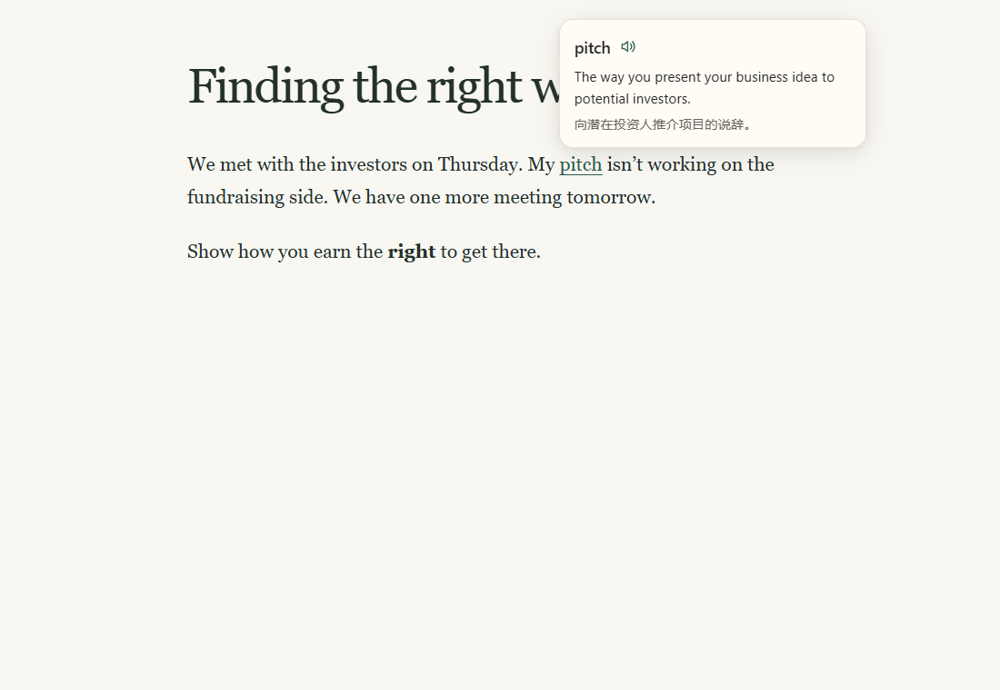

# Context · Edge 英语阅读助手

指向英文单词，轻按并松开键盘左侧的 Ctrl，原词旁会出现一句英文解释和一行中文释义。选中短语后，也可以用右键查义。此版本使用个人 OpenAI API Key。

[下载可直接加载的构建包](downloads/context-edge-1.0.0-dist.zip) · [中文安装说明](docs/安装说明.txt)

## 在 Windows Edge 上安装

1. 下载构建压缩包并全部解压到固定位置，例如 D 盘的 ContextEdge 文件夹。使用源码压缩包时也可直接使用其中的 dist 文件夹。
2. 在 Edge 地址栏打开 edge://extensions，启用「开发人员模式」，选择「加载解压缩的扩展」。
3. 选中 **dist** 文件夹。这一层应能直接看到 **manifest.json**。安装后请保留这个文件夹。
4. 从工具栏的扩展菜单打开 **Context → 打开设置**。填入个人 OpenAI API Key，确认模型名称后点击「保存设置」。默认模型为 **gpt-6-luna**，可改为你的项目有权访问且支持 Responses API 严格结构化输出的模型。真实查询的费用计入该 API 项目。
5. 刷新已经打开的英文网页，把鼠标指向正文中的一个单词，轻按左 Ctrl。安装后新打开的普通网页会自动启用。更新构建时，在扩展管理页点击 Context 的「重新加载」，然后刷新阅读页面。

可以从 OpenAI 项目设置创建 Key。保存后设置页会显示「已保存密钥」，再次打开时输入框留空。只改模型时可直接保存，移除密钥请点击「移除密钥」。[OpenAI API Keys](https://platform.openai.com/api-keys) · [Edge 本地加载说明](https://learn.microsoft.com/en-us/microsoft-edge/extensions/getting-started/extension-sideloading)

## 阅读操作

| 要做的事 | 操作 |
| --- | --- |
| 查一个词，包括链接里的词 | 鼠标指向字母，轻点左 Ctrl 即可。松键时触发，按住时间上限为半秒。 |
| 查一个短语 | 在同一段或同一条 X 帖子正文内拖选英文，右键选择「用 Context 解释」。 |
| 看补充说明 | 有补充时卡片才显示 More。也可用 Tab 聚焦，再按 Enter。 |
| 滚动时继续看释义 | 卡片跟着原词移动。原词滚出可见区域时，卡片暂时隐藏，滚回来即可继续看同一次查询。 |
| 调整阅读窗口 | 拖动 Edge 窗口边缘，已打开的卡片、文字和留白会一起缩放。窗口较矮时，可以在卡片内滚动查看完整释义。 |
| 关闭卡片 | 按 Esc、点卡片外或切换页面。换词会作废上一条结果。 |
| 暂停查词 | 在扩展面板关闭总开关，或打开「在此网站暂停」。暂停按主机名保存，同时作用于两种查词方式。 |

英文解释和中文释义都取自当前语境。例如，融资对话中的 *pitch* 指向投资人推介项目时的说辞。若点中的词属于习语，卡片标题可扩展为覆盖这次出现的连续原文短语。上下文不足时会提示无法确定含义。



另外两张截图展示设置页和从正式版 Edge 的原生右键菜单打开的短语卡片。截图使用模拟释义。[阅读设置](docs/edge-settings.png) · [右键短语](docs/edge-phrase.png)

## 上下文、密钥和缓存

- 鼠标移动只记录位置。提交查询时，用 Range 定位字形，TreeWalker 拼接正文文本，再用 Intl.Segmenter 划定词和句子。普通文章取当前段落。X 逐帖判断语言，只取当前帖子正文。
- 后台通过 HTTPS 请求官方 OpenAI Responses API，发送选词、句内位置、当前句、相邻文本和普通网页标题。当前句、前后文与标题合计最多 1,200 个 UTF-16 代码单元。请求设置 store=false。
- Key 存在当前 Edge 配置文件的本地扩展存储中。扩展在读写前将访问级别设为 TRUSTED_CONTEXTS。网页和内容脚本不能读取 Key。本地存储没有独立加密，有权限读取浏览器配置文件的人可能取得密钥。
- 首次查词使用流式响应。后台确认返回的词或短语覆盖所选位置后，英文解释和中文释义各自写完、通过校验便显示在卡片里。默认模型 `gpt-6-luna` 使用 `reasoning.effort=none` 以缩短生成前的等待。自定义模型使用其自身的推理设置。[模型说明](https://developers.openai.com/api/docs/models/gpt-6-luna)
- 完整结果通过校验后写入缓存。关闭卡片会取消当前请求，换词后只显示新词的结果。流中断时卡片会给出原因，可以手动重试。
- 缓存只保存散列索引、解释和时间。索引区分所选词语、位置、上下文、标题、模型、提示词版本和输出语言。最多 300 条，7 天到期，下次访问时清理过期项。超出容量时移除最久未使用项。

## 适用范围与排查

适用于支持 Manifest V3 的桌面 Edge 120 及以上版本。普通 HTTP(S) 网页的主文档和 X 的帖子正文可用。浏览器内部页、扩展商店、PDF 阅读器、iframe、图片或画布上的文字不在本版支持范围内。表单、可编辑区域和代码块会跳过。混合语言判断采用段落启发式，极短的无标记文本可能被跳过。X 的正文识别依赖其页面结构。

| 现象 | 检查方法 |
| --- | --- |
| 松开左 Ctrl 后没有卡片 | 先刷新网页，检查扩展的网站访问权限、总开关及本站暂停状态。把鼠标放在实际字母上，避开输入框、代码区和中文段落。 |
| 提示 Key 无效或模型不可用 | 在设置中更新 Key 或模型，检查该项目的模型访问权限和 API 账单。保存设置本身不会发送测试请求。 |
| 出现限流、额度不足、超时或断网提示 | 按卡片提示检查额度或网络。恢复后点击「再试一次」或重新查词。 |
| 模型返回不匹配的短语 | 卡片会提示短语没有准确覆盖所选位置。可重试，或直接选中需要解释的短语。 |

## 从源码构建与测试

需要 Node.js 22.12 或更高版本。构建使用 TypeScript 和 esbuild，输出到 dist。已解压的构建包可直接安装。

```sh
npm ci
npm run typecheck
npm test
npm run build
npx playwright install chromium
npm run test:e2e
```

浏览器测试会在临时配置文件里加载刚构建的扩展，用 Playwright 拦截真实后台发出的 Responses API 请求并返回测试数据。可用环境变量 CONTEXT_EDGE_BINARY 指向正式版 Edge 的可执行文件，再执行相同的浏览器测试。CONTEXT_SCREENSHOTS 可指定保存截图的目录。

| 验证项目 | 本次结果 |
| --- | --- |
| 类型检查、esbuild 构建 | 通过 |
| Vitest | 45 项通过，覆盖分词、精确位置、上下文预算、缓存、手势、流式响应和样例完整性。 |
| Playwright 自带 Chromium、Windows 正式版 Microsoft Edge 157.0.4341.60 | 两个浏览器各 26 项通过，覆盖窗口缩放时的字号、换行和定位，以及滚动跟随、分行显示、流中断与重试、缓存、快捷键和设置。 |
| Linux 正式版 Microsoft Edge 158.0.4370.33 | V1 初版的 22 项通过。另在有界面的 Edge 中拖选短语并点击原生菜单，拖选时请求数为 0，点击菜单后为 1。 |
| 普通键鼠行为 | 普通悬停、拖选、双击、复制、Ctrl 组合键、Ctrl 单击链接、Ctrl 滚轮和编辑器操作均有零 API 请求断言。 |
| 真实 OpenAI API | 本次测试使用模拟响应。线上生成耗时和真实释义质量待实测。 |

X 场景使用带帖子正文、账号栏、按钮和相邻帖的测试页面。标准 Playwright 用例通过真实拖选和右键事件取得选区，再发送菜单命令；有界面的 Edge 另行验证了原生菜单入口。

## 源码与释义质量样例

| 路径 | 内容 |
| --- | --- |
| src/content/ | 手势、字形定位、段落提取、请求生命周期和卡片 |
| src/background/ | 后台消息处理、Responses API、输出校验和本地缓存 |
| src/ui/、public/ | API Key 设置、工具栏和 Manifest V3 静态资源 |
| tests/ | Vitest 单元测试与 Playwright 浏览器测试 |
| dist/ | 可直接加载的构建 |
| examples/contexts.json | 30 条人工评估样例，含出处、选词位置、原句、邻近上下文、预期标题与中文含义要点 |

样例含计划中的 3 个原始用例，另有 27 条取自有出处的英文原文，覆盖融资、日常词义、口语、习语和指代。评估时按记录的位置查词，检查英文是否自然简短、中文是否准确，以及短语扩展是否必要。「指代不明」样例只提供截取的一句，预期返回 unclear。样例的预期含义是人工评审依据。[30 条语境样例](examples/contexts.json) · [原始实施计划](PLAN.md)
